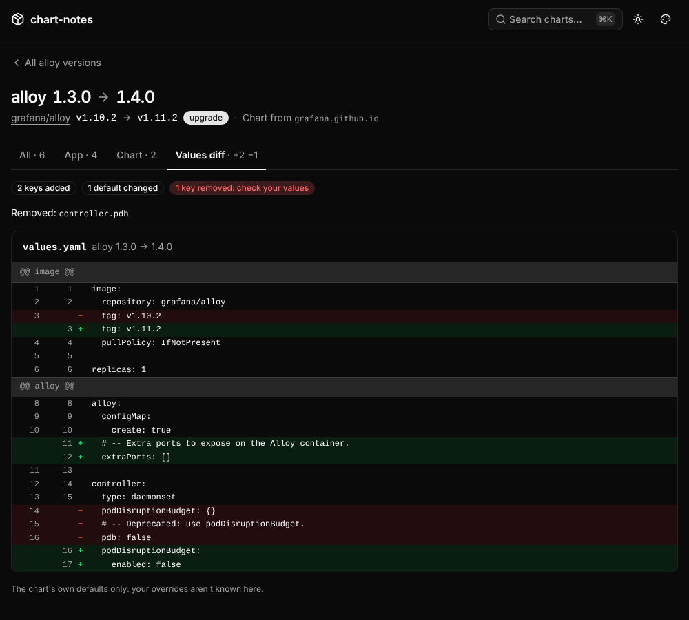

# renovate-extensions

Small services that fill gaps in what [Renovate](https://docs.renovatebot.com/)
shows in its PRs. Renovate has no plugin API, so each one is a web service a
custom PR table column links to.

Same stack and look as [dominium](https://github.com/PedDavid/dominium) and
[clavium](https://github.com/PedDavid/clavium): Rust, axum, askama, htmx and
Basecoat, with metrics on a separate port.

## chart-notes

Renovate's PRs for Helm chart bumps only carry the chart's own release notes,
which rarely say what changed in the app the chart packages. Renovate also
drops the chart's `appVersion`, so no PR template can link to the app's notes
directly.

`GET /<chart>?from=<version>&to=<version>&source=<sourceUrl>` shows what
changed between two chart versions, as one timeline, newest first:

- **Chart releases**, with their changes from the versions'
  `artifacthub.io/changes` annotations in the Helm repository's `index.yaml`.
  When the chart has none, they come from the chart repository's GitHub
  releases (chart-releaser tags them `<chart>-<version>`).
- **App releases**: the stable releases of the app between the two
  `appVersion`s, with their notes as GitHub renders them, and a link to the
  full diff. A downgrade lists what it rolls back.

Tabs filter it (**All**, **App**, **Chart**), and **Values diff** compares
the chart's default `values.yaml` between the two versions, read from each
version's package: a line diff by top-level key, and which keys were added,
changed or removed (a removed key you set no longer does anything). Each tab
has its own URL (`&tab=app|chart|values`).

The page answers as soon as the chart's index is known: the header shows
the versions right away and the rest loads into it. Without JavaScript,
`&full=1` renders everything in one response.


| The values diff (dark mode) | A chart's versions (dark mode) | All charts and the Renovate config |
|---|---|---|
|  |  |  |

- **`/`** lists the charts looked up so far, a form to look one up, and the
  Renovate config to paste, with this instance's URL filled in.
- **`/<chart>`** lists the chart's versions with their app versions, each
  linked to the notes for the bump from the one before, and a form to compare
  any two.
- **`/<chart>/badge.svg?…`** is the badge for Renovate's PR table (below).
- **⌘K** searches the charts looked up so far, or looks a new one up.

### Renovate config

```json5
"packageRules": [
  {
    "matchDatasources": ["helm"],
    // Renovate's default columns plus this one.
    "prBodyColumns": ["Package", "Type", "Update", "Change", "Pending", "Notes"],
    "prBodyDefinitions": {
      "Notes": "[](https://chart-notes.example.com/{{{packageName}}}?from={{{currentVersion}}}&to={{{newVersion}}}&source={{{sourceUrl}}})"
    }
  }
]
```

Only charts from Helm repositories (Renovate's `helm` datasource) are
covered, not OCI-hosted ones.

### The badge

The column is a badge linking to the notes page. Loading the badge starts
every lookup the page needs (the chart's repository, its changes, the app's
releases and their notes, the two packages for the values diff), so the page
is ready by the time someone clicks.
It answers within a second and a half either way: with what changed
(`app v1.10.2 → v1.11.2 · 4 releases`) once that's known, else
"looking up", and a later view shows the result.

Who fetches the badge depends on the forge:

| Forge | Fetched by | chart-notes on the LAN only |
|---|---|---|
| GitHub | GitHub's image proxy, from GitHub's servers | The badge doesn't show; its alt text still links to the page, which looks everything up when opened |
| Gitea, Forgejo | The viewer's browser (unless the instance's `[camo]` proxy is on) | Works |
| GitLab self-managed | The viewer's browser (unless an admin set up the asset proxy) | Works |

To have the badge on GitHub while keeping the pages on the LAN, expose only
`/<chart>/badge.svg` publicly (e.g. a second Ingress with a regex path, where
the controller supports one). The badge only shows versions and counts.

### Finding the chart

There's no list of charts to maintain. Renovate can't pass the Helm
repository's URL, but it passes `{{sourceUrl}}`: for Helm charts, the GitHub
repository the chart is released from (e.g. `grafana/helm-charts`). From
that:

1. **Helm repository:** the source repository's GitHub Pages site (where
   chart-releaser publishes), else the repositories Artifact Hub lists with
   a chart of that name: the one whose index gives the same source URL. With
   no `source` (a hand-typed URL), Artifact Hub's only match is used, or the
   only official or verified one; when several remain, the page asks which.
2. **App:** the first GitHub repository among the chart's `sources` and
   `home` that isn't the chart's own repository.
3. **Overrides** in the Helm chart's values cover what that gets wrong, per
   chart, with every field optional:

```yaml
overrides:
  kube-prometheus-stack:
    app: prometheus-operator/prometheus-operator   # its appVersion is the operator's
    note: Prometheus and Alertmanager can change without the appVersion changing.
  my-internal-chart:
    repo: https://charts.internal.example          # not on Artifact Hub
    app: me/my-app
    source: me/my-charts                           # GitHub releases with the chart's notes
```

Only URLs chart-notes derives are fetched: a `<owner>.github.io` site built
from a GitHub `owner/repo`, the repositories Artifact Hub lists, and
overrides. A `source` or `repo` in a request URL is never fetched as given.
Overrides are checked at startup: an unknown field, a non-http(s) `repo` or
an `app` that isn't `owner/repo` stops the pod with the reason in its log.

### Upstreams

- **Release notes.** GitHub renders each release's notes: issue links,
  mentions and commit references come out as on the release page. chart-notes
  removes anything that isn't safe to embed (scripts, styles, event
  handlers, non-http links), and the page only loads images from GitHub's
  hosts. Each release's notes take one API request. A page loads the 20
  newest app releases' notes and 10 chart releases', and links to the rest.
- **Chart packages** for the values diff are downloaded from the Helm
  repository (up to 20 MB each) and kept for a week: a published version
  doesn't change.
- **Caching.** Each chart's index entries, each app's release list and each
  release's notes are cached in memory for `cacheTtl` (10 minutes); where a
  chart comes from, for 36 times that. Per-chart and per-release entries
  nobody has asked for in a week are dropped. Concurrent requests for the same one share a single fetch.
  Refreshes are conditional (ETag), so an unchanged index isn't downloaded
  again and an unchanged release list doesn't count against GitHub's rate
  limit.
- **Failures.** When a refresh fails, the last good copy is served with a
  note saying how old it is. When GitHub can't be reached at all (or the rate
  limit is used up), the page still shows both app versions and the diff
  link. Only an unreachable Helm repository with nothing cached is an error
  page (502).
- **GitHub token.** Unauthenticated, GitHub allows 60 API requests an hour;
  a token, even one without scopes, allows 5000. Set `github.existingSecret`
  to a Secret holding one. It is mounted as a file, not passed in an
  environment variable.

### Metrics

On port 9090, with `/healthz` and `/readyz`, behind their own ClusterIP
Service (`serviceMonitor.enabled` scrapes it):

| Metric | |
|---|---|
| `chart_notes_pages_total{result}` | Notes pages: `ok`, `unknown_chart`, `unknown_version`, `upstream_error` (a 502, or a page with older or no releases) |
| `chart_notes_badges_total{result}` | Badges: `ready`, `pending` (still looking up), `error` |
| `chart_notes_upstream_requests_total{upstream,result}` | `helm`, `github` and `artifacthub` requests: `ok`, `not_modified`, `rate_limited`, `error` |
| `chart_notes_github_rate_limit_remaining` | GitHub requests left in the window (-1 before the first request) |
| `chart_notes_github_rate_limit_reset_timestamp_seconds` | When the window resets |
| `chart_notes_overrides` | Charts with an override |
| `chart_notes_build_info{version}` | The running version |

### Deploying

```sh
helm install chart-notes oci://ghcr.io/peddavid/charts/chart-notes \
  -n chart-notes --create-namespace \
  --set ingress.enabled=true --set ingress.host=chart-notes.example.com \
  --set github.existingSecret=chart-notes-github
```

Options are documented in [`values.yaml`](deploy/helm/chart-notes/values.yaml).
The pod runs as non-root with a read-only root filesystem, no capabilities
and no service account token. The pages only show public data; see
[The badge](#the-badge) for what needs to be reachable from where.

Every push to `main` publishes `ghcr.io/peddavid/renovate-extensions/chart-notes`
tagged `sha-<commit>` and `main`, plus the chart's `appVersion` the first time
that version is seen. The chart is published to
`oci://ghcr.io/peddavid/charts/chart-notes` the first time its `version` is
seen: chart changes need a version bump to be published.

### Developing

```sh
make demo             # http://localhost:8080, sample data, no network
make check            # fmt, clippy, tests: what CI's check job runs
make visual-browsers  # once: the Chromium the Playwright driver expects
make visual           # browser tests: the ⌘K palette and the screenshots
make css              # after changing templates or assets/app.css (Tailwind v4 standalone CLI)
make helm-lint        # lint and render the chart, plus deploy/helm/tests/render.sh (needs yq)
make image            # build the container image
```

The `--demo` pages are rendered at a fixed moment (`demo_state` in
`chart-notes/tests/common/mod.rs`), and the Helm and GitHub clients are tested
against fake servers (caching, ETags, pagination, rate limits, stale copies).
The pages are checked three ways:

- **HTML snapshots** (`tests/snapshots.rs`, [insta](https://insta.rs)) run with
  `cargo test`. After an intended markup change, accept it with
  `cargo insta review`.
- **Screenshots** (`tests/visual.rs`,
  [playwright-rs](https://github.com/padamson/playwright-rust)) drive Chromium
  against the router in-process. They cover the chart list (light, and dark
  with a palette), a chart's versions, notes for an upgrade, a downgrade, the
  same app version, a chart note, GitHub being down, a 404 and the ⌘K palette.
  Each is compared with `chart-notes/tests/screenshots/*.png`. The test-only
  Playwright driver brings its own Node.js.
- **Behaviour** (`tests/palette.rs`, same harness) checks the ⌘K palette's
  ARIA combobox state while moving through results, and that reopening it
  with a search still in flight never follows a stale result.

Fonts and antialiasing vary between machines, so the screenshot baselines are
rendered on `ubuntu-24.04`, the runner CI's `visual` job uses. When that job
fails, its `screenshots` artifact has each `-actual.png` and `-diff.png`. When
the change is intended, label the PR `update-screenshots`. The Screenshots
workflow then renders a new set, checks it and commits it to the PR's branch,
where the images can be reviewed in the diff. Running that workflow by hand
does the same on any branch.

Commits pushed with the workflow's own token don't start CI, so the checks
don't re-run on the baseline commit until the next push. To have them re-run
straight away, store a token that can push to this repository
(a fine-grained token with *Contents: read and write*) as the
`SCREENSHOTS_TOKEN` Actions secret.

WCAG contrast of every colour palette is checked from the CSS
(`tests/contrast.rs`).
