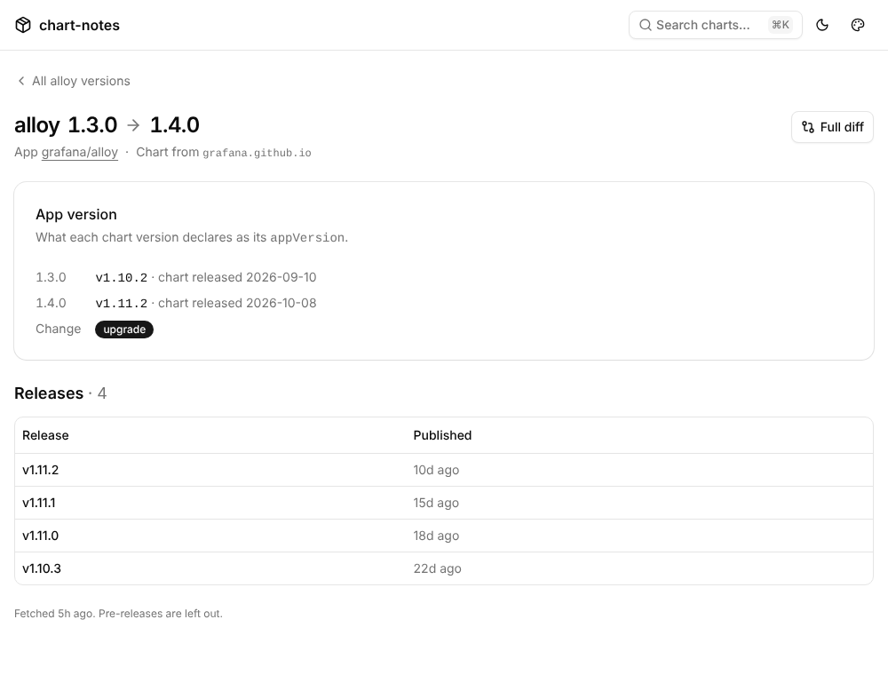
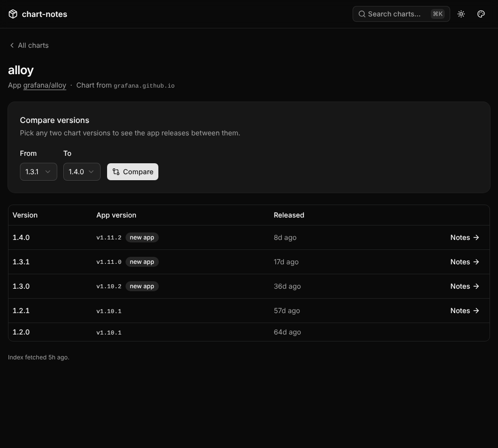
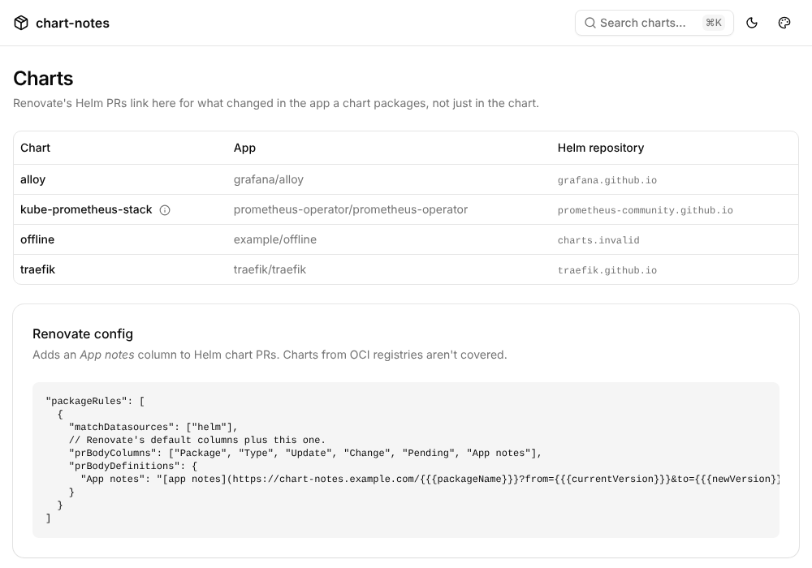

# renovate-extensions

Small services that fill gaps in what [Renovate](https://docs.renovatebot.com/)
shows in its PRs. Renovate has no plugin API, so each one is a web service a
custom PR table column links to.

Same stack and look as [dominium](https://github.com/PedDavid/dominium) and
[clavium](https://github.com/PedDavid/clavium): Rust, axum, askama, htmx and
Basecoat, with metrics on a separate port.

## chart-notes

Renovate's PRs for Helm chart bumps only carry the chart's own release notes,
which rarely say what changed in the app the chart packages. Renovate also
drops the chart's `appVersion`, so no PR template can link to the app's notes
directly.

`GET /<chart>?from=<version>&to=<version>` reads `appVersion` for both chart
versions from the chart repository's `index.yaml`, then lists the app's stable
GitHub releases in between, with a link to the full diff. When the app version
didn't change, it says so; a downgrade lists what it rolls back.



| A chart's versions (dark mode) | All charts and the Renovate config |
|---|---|
|  |  |

- **`/`** lists the known charts and the Renovate config to paste, with this
  instance's URL filled in.
- **`/<chart>`** lists the chart's versions with their app versions, each
  linked to the notes for the bump from the one before, and a form to compare
  any two.
- **⌘K** searches the charts.

### Renovate config

```json5
"packageRules": [
  {
    "matchDatasources": ["helm"],
    // Renovate's default columns plus this one.
    "prBodyColumns": ["Package", "Type", "Update", "Change", "Pending", "App notes"],
    "prBodyDefinitions": {
      "App notes": "[app notes](https://chart-notes.example.com/{{{packageName}}}?from={{{currentVersion}}}&to={{{newVersion}}})"
    }
  }
]
```

Only charts from Helm repositories (Renovate's `helm` datasource) are
covered, not OCI-hosted ones.

The old `/<chart>/<from>/<to>` form is gone: links to it in open PRs return
404 until Renovate next updates those PRs.

### Charts

A chart name alone doesn't say which repository it comes from (`loki` is in
grafana-community's, `alloy` in grafana's), so each chart is listed in
[`chart-notes/charts.yaml`](chart-notes/charts.yaml) with its Helm repository
and the GitHub repository of its app. The Helm chart's `charts` value adds to
that list or replaces entries without a new image:

```yaml
charts:
  my-chart:
    repo: https://charts.example.com   # serves index.yaml
    app: owner/repo                    # the app's GitHub releases
    note: Optional caveat shown on the page.
```

Entries are checked at startup: an unknown field, a non-http(s) `repo` or an
`app` that isn't `owner/repo` stops the pod with the reason in its log.

### Upstreams

- **Caching.** Each Helm index and each app's releases are cached in memory
  for `cacheTtl` (10 minutes). Concurrent requests for the same one share a
  single fetch. Refreshes are conditional (ETag), so an unchanged index isn't
  downloaded again and an unchanged release list doesn't count against
  GitHub's rate limit.
- **Failures.** When a refresh fails, the last good copy is served with a
  note saying how old it is. When GitHub can't be reached at all (or the rate
  limit is used up), the page still shows both app versions and the diff
  link. Only an unreachable Helm repository with nothing cached is an error
  page (502).
- **GitHub token.** Unauthenticated, GitHub allows 60 API requests an hour;
  a token, even one without scopes, allows 5000. Set `github.existingSecret`
  to a Secret holding one. It is mounted as a file, not passed in an
  environment variable.

### Metrics

On port 9090, with `/healthz` and `/readyz`, behind their own ClusterIP
Service (`serviceMonitor.enabled` scrapes it):

| Metric | |
|---|---|
| `chart_notes_pages_total{result}` | Notes pages: `ok`, `unknown_chart`, `unknown_version`, `upstream_error` (a 502, or a page with older or no releases) |
| `chart_notes_upstream_requests_total{upstream,result}` | `helm` and `github` requests: `ok`, `not_modified`, `rate_limited`, `error` |
| `chart_notes_github_rate_limit_remaining` | GitHub requests left in the window (-1 before the first request) |
| `chart_notes_github_rate_limit_reset_timestamp_seconds` | When the window resets |
| `chart_notes_charts` | Charts known |
| `chart_notes_build_info{version}` | The running version |

### Deploying

```sh
helm install chart-notes oci://ghcr.io/peddavid/charts/chart-notes \
  -n chart-notes --create-namespace \
  --set ingress.enabled=true --set ingress.host=chart-notes.example.com \
  --set github.existingSecret=chart-notes-github
```

Options are documented in [`values.yaml`](deploy/helm/chart-notes/values.yaml).
The pod runs as non-root with a read-only root filesystem, no capabilities
and no service account token. The pages are public, since Renovate PRs link
to them, and only show public data.

Every push to `main` publishes `ghcr.io/peddavid/renovate-extensions/chart-notes`
tagged `sha-<commit>` and `main`, plus the chart's `appVersion` the first time
that version is seen. The chart is published to
`oci://ghcr.io/peddavid/charts/chart-notes` the first time its `version` is
seen: chart changes need a version bump to be published.

### Developing

```sh
make demo        # http://localhost:8080, sample data, no network
make check       # fmt, clippy, tests: what CI runs
make css         # after changing templates or assets/app.css (Tailwind v4 standalone CLI)
make helm-lint   # lint and render the chart, plus deploy/helm/tests/render.sh (needs yq)
make image       # build the container image
```

The tests cover the pages against the demo data, the Helm and GitHub clients
against fake servers (caching, ETags, pagination, rate limits, stale copies),
the rendered HTML (insta snapshots in `chart-notes/tests/snapshots`; review
changes with `cargo insta review`), and WCAG contrast of every colour palette.
